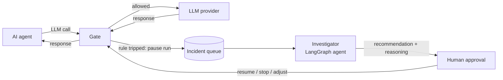

# Agent Circuit Breaker

A fuse box for AI agents.

## The story

An AI agent is a program that uses a large language model (LLM) to decide what to do next,
does it, looks at the result, and decides again, over and over until the job is done. That
loop is what makes agents useful. It is also what makes them dangerous to your wallet. If the
agent gets confused, for example by retrying a failing tool forever or asking the same question
in slightly different words, nothing stops it. Every turn of the loop is a paid LLM call. Leave
it running overnight and you can wake up to a bill for thousands of dollars and an agent that
achieved nothing.

Your house has a fuse box for exactly this kind of problem. When one circuit draws too much
current, that one fuse trips, the rest of the house stays on, and someone goes and looks at
what went wrong before flipping it back.

Agent Circuit Breaker does the same thing for agents:

1. A **gate** sits between the agent and its LLM provider. Every call passes through it.
2. The gate records each call in a **store** and checks it against **rules** (too many steps,
   over budget, the same call repeated). All limits come from `config/settings.yaml`.
3. When a rule trips, the gate pauses **that one run** (other runs keep going) and puts an
   incident on a **queue**.
4. An **investigator**, itself a small LangGraph agent, reads the run's history and works out
   what went wrong. It saves every decision together with its reasoning.
5. Before anything drastic (killing the run, raising its budget), a **human** is asked for
   approval through a **notifier**. Their answer goes back to the gate, which resumes or stops
   the run.

It starts on your laptop and ends up running on AWS. Each piece talks through a small
interface, so the local version of the store, queue or notifier can be swapped for an AWS one
without rewriting the rest.

## Final design



## Getting started

Requires Python 3.12+ and [uv](https://docs.astral.sh/uv/).

```bash
uv sync            # create .venv and install everything
uv run pytest      # run the tests
uv run ruff check . # lint
```

Settings live in `config/settings.yaml`. Override any value with an environment variable named
`BREAKER_<SECTION>__<KEY>`, for example:

```bash
BREAKER_LIMITS__MAX_STEPS_PER_RUN=50 uv run pytest
```

## Layout

```
src/breaker/
  gate/          the checkpoint in front of the LLM provider
  store/         remembers runs, steps and spending
  rules/         small checks that spot a run going wrong
  investigator/  LangGraph agent that explains why a run was paused
  queue/         incidents waiting for investigation
  notify/        asks a human for approval
  config/        settings loader
config/          settings.yaml
tests/           pytest tests
scenarios/       scripted "misbehaving agent" runs for demos and tests
scripts/         helper scripts
infra/           Terraform for AWS (later parts)
docs/lessons/    one lesson per part
```

## Lessons

See [docs/lessons/README.md](docs/lessons/README.md).
